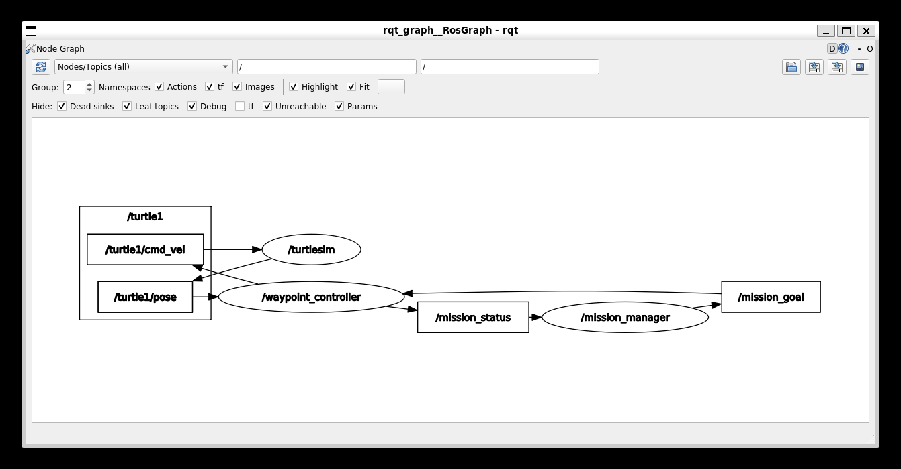

# waypoint_patrol: Level 1 Waypoint Patrol (ROS 1 Noetic)

Nama: Charlie Antoni Yusup
NRP: 5022241023
Mata kuliah: SRO
Level: 1

## Deskripsi

Package ini menggerakkan `turtle1` di turtlesim secara otonom mengikuti jalur segi lima: lima sudut ditambah satu titik penutup (enam waypoint) yang dikunjungi berurutan, lalu berhenti di waypoint terakhir. Gerakan hanya dikirim lewat `/turtle1/cmd_vel`. Setiap keputusan gerak dihitung dari `/turtle1/pose` dengan kontroler proporsional (P-controller), jadi sistem berjalan closed loop dan tidak bergantung pada waktu atau `sleep`.

Lingkungan pengujian: Ubuntu 20.04 (WSL2 di Windows 11), ROS Noetic, Python 3.

## Struktur package

```
waypoint_patrol/
├── CMakeLists.txt
├── package.xml
├── README.md
├── docs/
│   ├── rqt_graph.png         screenshot graf node dan topic
│   └── demo_level1.mp4       video demo
├── config/
│   ├── waypoints.yaml        daftar waypoint (satu-satunya tempat)
│   └── controller.yaml       gain dan toleransi kontroler
├── launch/
│   └── patrol.launch         menjalankan turtlesim + 2 node
├── msg/
│   ├── MissionGoal.msg
│   └── MissionStatus.msg
├── srv/
│   └── StartMission.srv
└── scripts/
    ├── mission_manager.py
    └── waypoint_controller.py
```

## Cara build dan menjalankan

Repository ini (`SRO`) berisi beberapa tugas. Package ROS ada di `Having_Fun_with_Turtlesim/waypoint_patrol/`. Clone repository ke dalam catkin workspace (`~/catkin_ws/src/`), lalu build. `catkin_make` menemukan package di dalam subfolder secara otomatis.

```bash
cd ~/catkin_ws/src
git clone https://github.com/antonnn27/SRO.git
cd ~/catkin_ws
catkin_make
source devel/setup.bash
roslaunch waypoint_patrol patrol.launch
```

Satu perintah `roslaunch` menyalakan `roscore`, `turtlesim_node`, `waypoint_controller`, dan `mission_manager`. Misi dimulai otomatis sekitar 2 detik setelah launch, dan misi selesai setelah semua waypoint dikunjungi.

Untuk mengulang misi tanpa menjalankan ulang launch, panggil service dari terminal lain (setelah misi sebelumnya selesai):

```bash
rosservice call /start_mission
```

Untuk menjalankan tanpa mulai otomatis, lalu memulai misi lewat service:

```bash
roslaunch waypoint_patrol patrol.launch auto_start:=false
rosservice call /start_mission
```

Setiap kali file `.msg` atau `.srv` diubah, jalankan `catkin_make` lagi. Perubahan pada file `.py` dan `.yaml` tidak perlu build ulang.

## Mengubah waypoint

Edit `config/waypoints.yaml`. Format tiap titik adalah `[x, y]`, dan urutan di list adalah urutan kunjungan.

```yaml
waypoints:
  - [5.5, 9.5]
  - [1.7, 6.74]
  - [3.15, 2.26]
  - [7.85, 2.26]
  - [9.3, 6.74]
  - [5.5, 9.5]
```

Contoh di atas adalah segi lima beraturan dengan pusat (5.5, 5.5) dan jari-jari 4. Titik keenam mengulang titik pertama agar sisi terakhir tertutup. Jumlah titik bebas, asalkan minimal empat.

Area turtlesim berukuran sekitar 11 x 11 unit, jadi pilih titik di antara kira-kira 0,5 dan 10,5 agar kura-kura tidak menabrak dinding. Daftar ini dimuat sebagai parameter oleh `mission_manager` lewat file launch, dan tidak ada koordinat waypoint di dalam kode Python.

## Node

### mission_manager (`scripts/mission_manager.py`)

Mengatur urutan waypoint. Node ini menyimpan daftar waypoint dan indeks titik yang sedang dituju.
- Mengirim titik tujuan ke `/mission_goal`, satu titik setiap kali.
- Membaca `/mission_status`. Jika controller melaporkan `reached` dan `goal_id` laporan itu sama dengan `goal_id` tujuan terakhir yang dikirim, node ini pindah ke waypoint berikutnya.
- Setelah waypoint terakhir tercapai, node mengirim tujuan dengan `active = false` dan mencetak `MISI SELESAI`.
- Menyediakan service `/start_mission` untuk memulai misi. Jika misi masih berjalan, service menjawab `success: False`.
- Jika parameter `auto_start` bernilai `true` (default di file launch), misi dimulai sendiri 2 detik setelah node menyala. Jeda ini hanya menunggu node lain siap, bukan bagian dari keputusan gerak.

### waypoint_controller (`scripts/waypoint_controller.py`)

Menghitung perintah gerak untuk menuju satu titik tujuan. Node ini berjalan pada 20 Hz (`rospy.Timer`). Pada tiap siklus:

1. Jika pose belum diterima, atau belum ada tujuan, atau tujuan tidak aktif, node mengirim `Twist` nol (berhenti).
2. Menghitung jarak ke tujuan `d = hypot(dx, dy)` dan galat sudut `e = atan2(dy, dx) - theta`, lalu `e` dinormalkan ke rentang [-pi, pi] agar kura-kura berbelok lewat sisi yang lebih pendek.
3. Jika `d < tolerance`, kura-kura berhenti dan `reached = true`.
4. Jika belum, `angular.z = kw * e`. Kecepatan maju `linear.x = min(kv * d, 2.0)` hanya diberikan ketika `|e| < 0.3` rad. Dengan syarat ini kura-kura berputar menghadap target lebih dulu, baru maju, sehingga tidak berputar mengitari titik tujuan.
5. Mengirim `Twist` ke `/turtle1/cmd_vel` dan `MissionStatus` ke `/mission_status`.

## Topic

| Topic | Tipe | Publisher | Subscriber |
|---|---|---|---|
| `/turtle1/pose` | `turtlesim/Pose` | turtlesim | waypoint_controller |
| `/turtle1/cmd_vel` | `geometry_msgs/Twist` | waypoint_controller | turtlesim |
| `/mission_goal` | `waypoint_patrol/MissionGoal` | mission_manager | waypoint_controller |
| `/mission_status` | `waypoint_patrol/MissionStatus` | waypoint_controller | mission_manager |

`/mission_goal` dipublikasikan dengan `latch=True`, sehingga tujuan terakhir tetap diterima oleh controller yang baru menyala.

## Message dan service custom

**`msg/MissionGoal.msg`**: tujuan dari manager ke controller.

| Field | Tipe | Arti |
|---|---|---|
| `goal_id` | `int32` | nomor urut tujuan, naik setiap tujuan baru |
| `x`, `y` | `float32` | koordinat tujuan |
| `active` | `bool` | `false` berarti berhenti (tidak ada tujuan) |

**`msg/MissionStatus.msg`**: laporan dari controller ke manager.

| Field | Tipe | Arti |
|---|---|---|
| `goal_id` | `int32` | tujuan yang sedang dikerjakan (-1 jika tidak ada) |
| `x`, `y` | `float32` | posisi turtle1 saat ini |
| `distance_to_goal` | `float32` | jarak tersisa ke tujuan |
| `reached` | `bool` | `true` jika jarak < toleransi |

Field `goal_id` dipakai agar laporan "sudah sampai" milik titik sebelumnya, yang masih mungkin ada di antrean, tidak dianggap sebagai laporan untuk titik yang baru dikirim.

**`srv/StartMission.srv`**: memulai misi.

```
---
bool success
string message
```

Tidak ada input. Respons `success: True` dengan `message: "Misi dimulai"` jika misi berhasil dimulai, atau `success: False` dengan `message: "Misi sedang berjalan"` jika misi masih berjalan.

## Parameter kontroler

Dimuat dari `config/controller.yaml` ke namespace `waypoint_controller`.

| Parameter | Nilai | Arti |
|---|---|---|
| `kv` | 1.5 | gain kecepatan linear (`v = kv * d`) |
| `kw` | 4.0 | gain kecepatan sudut (`w = kw * e`) |
| `tolerance` | 0.08 | jarak (unit) saat titik dianggap tercapai; syarat tugas < 0.1 |
| `rate` | 20.0 | frekuensi siklus kontrol (Hz) |

## Hasil

- Semua kriteria Level 1 terpenuhi: kura-kura mengunjungi enam waypoint berurutan (jalur segi lima tertutup), berhenti dengan toleransi 0,08 unit, dan berhenti setelah waypoint terakhir.
- Gerakan hanya lewat `/turtle1/cmd_vel`. `turtle_teleop_key`, `/turtle1/teleport_absolute`, dan `/turtle1/teleport_relative` tidak dipakai.
- Screenshot `rqt_graph`: `docs/rqt_graph.png`.
- Video demo: `docs/demo_level1.mp4`.



Contoh log saat misi berjalan:

```
[INFO] Waypoint 1 tercapai
[INFO] Waypoint 2 tercapai
[INFO] Waypoint 3 tercapai
[INFO] Waypoint 4 tercapai
[INFO] Waypoint 5 tercapai
[INFO] Waypoint 6 tercapai
[INFO] MISI SELESAI
```
